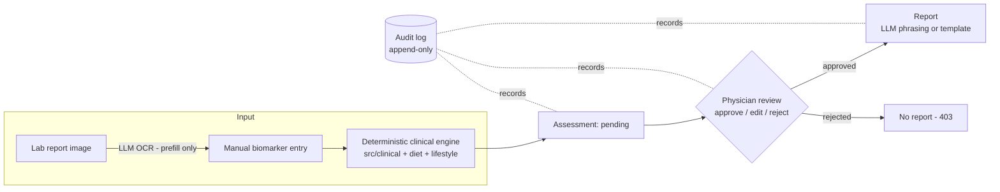

# Physician-Supervised Health System

A physician-supervised diet & lifestyle recommendation web app (Bangladesh
context). All medical decisions come from a **deterministic, cited rule
engine**; an LLM is used **only** for lab-report OCR and report phrasing; and
**no patient ever sees a report their physician hasn't approved**.

## Architecture



Three hard guarantees, each enforced by a test:

| Guarantee | Enforcement |
|---|---|
| Clinical logic never depends on an LLM | `tests/test_llm_isolation.py` — AST scan: `src/clinical`, `src/diet`, `src/lifestyle` never import `src.llm` |
| Contraindicated items never reach recommendations | `src/clinical/contraindication.py` gate runs before ranking; `tests/test_contraindication.py` |
| No report without physician approval | `GET /report/{visit_id}` returns 403 until an `Approval` row exists; `tests/test_api_gate.py` |

Every threshold is cited in `data/reference/*.yaml` (ADA 2024 glucose, ACC/AHA
2017 blood pressure, WHO 2011 hemoglobin, NIH/IOM RDAs, ACSM exercise
prescription). The app runs fully without an Anthropic API key — OCR returns a
clear 503 and reports fall back to a deterministic Bangla/English template.

## Quickstart

### Backend (FastAPI + SQLite — no external services needed)

```powershell
# one-time setup (from the project root) — requires 64-bit Python 3.13+
py -3.13 -m venv .venv
.venv\Scripts\python.exe -m pip install -e ".[dev]"

# create + seed the database with 4 synthetic demo patients
.venv\Scripts\python.exe scripts\seed_db.py

# run the API  →  http://localhost:8000/docs
.venv\Scripts\python.exe -m uvicorn src.api.main:app --reload
```

> **64-bit Python required.** `scikit-learn`/`scipy` (the food-recommender
> model's training dependencies, see below) have no prebuilt wheels for
> 32-bit Windows Python and this machine has no C compiler to build them
> from source — use a 64-bit interpreter.

### Dashboard (Next.js — http://localhost:3000)

```powershell
cd dashboard
npm install
npm run dev
```

### Run both together

`npm run dev` from the project root (`scripts/dev.ps1`) starts the API in its
own window, waits for `/health`, then runs the dashboard in the foreground —
useful once both are set up so you don't have to juggle two shells.

> **Known quirk:** this can report a failed exit code (e.g. exit 4) even
> when both servers started fine. `dev.ps1` sets
> `$ErrorActionPreference = "Stop"`, and Windows PowerShell 5.1 treats
> `npm`'s informational `npm notice run ...` lines (written to stderr) as
> terminating errors — the wrapper aborts, but the API (its own process) and
> `next dev` (already attached to your terminal) keep running unaffected.
> If a background/CI runner reports this task as "failed," check
> `http://localhost:8000/health` and `http://localhost:3000` directly before
> assuming the app didn't start.

### Accounts, roles & dashboards

The app has three role-based dashboards, each with its own sign-in page
(chosen from the portal page at `/login`):

| Role | Dashboard | How you get an account |
|---|---|---|
| **Admin** | `/admin` — platform stats, doctor approvals, users, audit feed | Created automatically at first API startup from `ADMIN_EMAIL` / `ADMIN_PASSWORD` in `.env` (default `admin@health.local` / `admin12345`) |
| **Doctor** | `/doctor` — patients, intake, review queue, reports | Self-registers at `/register/doctor` → lands in the admin's **pending approvals**; can sign in only after the admin approves |
| **Patient** | `/patient` — own visits, review status, approved reports | Self-registers at `/register/patient` (active immediately; account is linked to a new patient record) |

`scripts\seed_db.py` also seeds demo logins: `doctor@health.local` /
`doctor12345` (active), `pending.doctor@health.local` / `doctor12345`
(awaiting approval — use it to demo the approval flow), and
`patient@health.local` / `patient12345` (linked to the first demo patient).

All workflow API routes require a signed-in doctor or admin; patients can
only read their own dashboard and their own **approved** reports (the 403
report gate is unchanged). Sessions are HMAC-signed tokens (stdlib-only, no
extra dependencies) — set a strong `SECRET_KEY` in `.env` outside dev.

### Optional: enable LLM features

Copy `.env.example` to `.env` and set `ANTHROPIC_API_KEY`. This enables:
- **OCR prefill** on the intake form (lab-report image → biomarker values —
  the physician still confirms every value), and
- **LLM-phrased reports** in plain Bangla/English (otherwise a deterministic
  template is used).

### Optional: PostgreSQL

`docker compose up -d`, then set `DATABASE_URL` in `.env` (see
`docker-compose.yml`) and `pip install "psycopg[binary]"`.

## Adding your datasets

The CSVs currently hold clearly-flagged **DEMO rows** (`source = DEMO`) so the
app is demonstrable. To load real data:

1. Replace the rows in `data/food/bd_food.csv`, `data/recipe/recipes.csv` +
   `recipe_ingredients.csv`, and `data/lifestyle/exercises.csv`, keeping the
   exact columns. Each dataset's `schema.md` defines every column, unit, and
   the tag vocabulary. Cite the source of each row in its `source` column.
2. Validate: `.venv\Scripts\python.exe scripts\validate_datasets.py` — checks
   types, ranges, ID formats, and referential integrity (every
   `recipe_ingredients.food_id` must exist in `bd_food.csv`), and writes a
   `validation_report.md` into each dataset folder.
3. Snapshot the version: copy the CSV into its `snapshots/` folder with a
   dated name (e.g. `v0.2_2026-08-01.csv`).
4. Re-seed if desired: delete `health.db` and run `scripts\seed_db.py`.

`data/reference/*.yaml` (biomarker ranges, RDIs, contraindication rules) are
**real cited clinical constants**, not demo data — edit only with a citation.

## Food recommendation model

Food/recipe ranking (`src/diet/matcher.py`) uses a trained model when one is
available, and otherwise falls back to a deterministic linear formula — same
optional-and-gracefully-degrading shape as the LLM features. The
contraindication gate (`src/clinical/contraindication.py`) is unaffected
either way: it always runs first, and the model only ever re-ranks items the
gate already allowed.

To train it: `.venv\Scripts\python.exe scripts\train_food_recommender.py`
(a few minutes). This builds a synthetic patient-archetype training set from
the app's own cited reference data (no real preference data exists yet),
hyperparameter-tunes a `RandomForestRegressor` and a
`HistGradientBoostingRegressor` (via `RandomizedSearchCV`, grouped by
archetype, optimizing held-out Spearman correlation) alongside an untuned
`GradientBoostingRegressor` and a `LinearRegression` baseline, and reports a
five-way comparison against the hand-tuned formula on patient archetypes
held out of training — currently `HistGradientBoostingRegressor` wins
(Spearman ≈0.97 vs. ≈0.67 for the hand-tuned formula) and ships as a ~500 KB
artifact. Writes `data/models/food_recommender.joblib` (gitignored — a
regenerable build artifact, not a reference file) and
`data/models/food_recommender_metrics.json` (includes the tuned
hyperparameters found, for the thesis record). Every assessment records
which backend actually produced it: `result.nutrition.scoring_backend` is
`"ml"` or `"linear"`. See `notebooks/04_recommender_training.ipynb` for the
thesis figures/tables.

**Known limitation:** a handful of dry, concentrated items (tea/coffee
powder) still rank higher than they should for the same reason spices used
to — `bd_food.csv`'s nutrient columns are per-100g, and nobody brews 100g of
tea powder. The spice/oil food groups already carry a correcting penalty in
`scripts/train_food_recommender.py`'s label (see `_BASELINE_GROUP_PRIOR`);
tea/coffee sit in the `other` group alongside genuinely good picks (nuts,
seeds), so the same blanket penalty can't apply there without also
suppressing those. Fixing it properly needs a data-level tag (e.g.
`brewed_beverage` on the ~5 affected `bd_food.csv` rows) that the label
function can penalize specifically — not yet done.

## Workflow (what the app does)

1. **Intake** — create a patient, then a visit with weight + biomarkers
   (fasting glucose, blood pressure, hemoglobin). Optionally upload a lab
   report image to prefill the form via OCR.
2. **Engine** — the deterministic engine immediately computes BMI (WHO Asian
   cutoffs), risk flags, derived conditions, nutrient targets (RDI +
   deficiency emphasis), a contraindication-filtered food/recipe ranking, a
   one-day meal plan, and an ACSM FITT-VP exercise prescription. Stored as a
   **pending** assessment.
3. **Review** — the physician sees the queue, inspects the full assessment,
   and approves / edits / rejects. Every decision is written to the
   append-only audit log.
4. **Report** — only after approval, `GET /report/{visit_id}?lang=bn|en`
   returns the patient report (LLM-phrased if configured, template otherwise).

## Tests

```powershell
.venv\Scripts\python.exe -m pytest
```

`tests/test_risk_scoring.py` is the threshold validation table (doubles as the
thesis validation table — exported to CSV by `notebooks/03_results_figures.ipynb`).

## Project layout

```
data/          datasets (schema.md + snapshots + validation reports) and cited reference YAMLs
data/models/   trained food-recommender artifact (gitignored, regenerable — see scripts/train_food_recommender.py)
src/clinical   deterministic rules: BMI, risk scoring, deficiency → targets, contraindication gate
src/diet       food DB, recipe nutrition (computed from ingredients), matcher, meal plan, recommender (ML backend)
src/lifestyle  exercise DB, ACSM FITT-VP prescription, intensity scaling
src/llm        OCR + phrasing only (env-gated Claude; app fully works without it)
src/api        FastAPI: intake, review, report (403-gated), patients
src/db         SQLAlchemy models: Patient, Visit, Assessment, Approval, AuditLog
src/core       config, logging, append-only audit helpers
dashboard/     Next.js physician UI
tests/         validation tables + gate/isolation tests + synthetic fixtures
scripts/       validate_datasets.py, seed_db.py, train_food_recommender.py
notebooks/     dataset audit, cross-validation, thesis figure export, recommender training
thesis/        diagrams / figures / results
```
