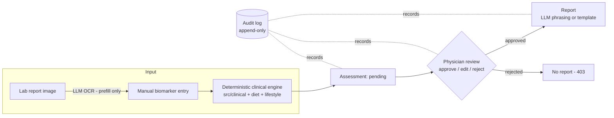

# Physician-Supervised Health System

A physician-supervised diet & lifestyle recommendation web app (Bangladesh
context). All medical decisions come from a **deterministic, cited rule
engine**; an LLM is used **only** for lab-report OCR and report phrasing; and
**no patient ever sees a report their physician hasn't approved**.

## Architecture



Three hard guarantees, each enforced by a test:

| Guarantee | Enforcement |
|---|---|
| Clinical logic never depends on an LLM | `tests/test_llm_isolation.py` — AST scan: `src/clinical`, `src/diet`, `src/lifestyle` never import `src.llm` |
| Contraindicated items never reach recommendations | `src/clinical/contraindication.py` gate runs before ranking; `tests/test_contraindication.py` |
| No report without physician approval | `GET /report/{visit_id}` returns 403 until an `Approval` row exists; `tests/test_api_gate.py` |

Every threshold is cited in `data/reference/*.yaml` (ADA 2024 glucose, ACC/AHA
2017 blood pressure, WHO 2011 hemoglobin, NIH/IOM RDAs, ACSM exercise
prescription). The app runs fully without an Anthropic API key — OCR returns a
clear 503 and reports fall back to a deterministic Bangla/English template.

## Quickstart

### Backend (FastAPI + SQLite — no external services needed)

```powershell
# one-time setup (from the project root) — requires 64-bit Python 3.13+
py -3.13 -m venv .venv
.venv\Scripts\python.exe -m pip install -e ".[dev]"

# create + seed the database with 4 synthetic demo patients
.venv\Scripts\python.exe scripts\seed_db.py

# run the API  →  http://localhost:8000/docs
.venv\Scripts\python.exe -m uvicorn src.api.main:app --reload
```

> **64-bit Python required.** `scikit-learn`/`scipy` (the recommender
> models' training dependencies, see below) have no prebuilt wheels for
> 32-bit Windows Python and this machine has no C compiler to build them
> from source — use a 64-bit interpreter.

### Dashboard (Next.js — http://localhost:3000)

```powershell
cd dashboard
npm install
npm run dev
```

### Run both together

`npm run dev` from the project root (`scripts/dev.ps1`) starts the API in its
own window, waits for `/health`, then runs the dashboard in the foreground —
useful once both are set up so you don't have to juggle two shells.

> **Known quirk:** this can report a failed exit code (e.g. exit 4) even
> when both servers started fine. `dev.ps1` sets
> `$ErrorActionPreference = "Stop"`, and Windows PowerShell 5.1 treats
> `npm`'s informational `npm notice run ...` lines (written to stderr) as
> terminating errors — the wrapper aborts, but the API (its own process) and
> `next dev` (already attached to your terminal) keep running unaffected.
> If a background/CI runner reports this task as "failed," check
> `http://localhost:8000/health` and `http://localhost:3000` directly before
> assuming the app didn't start.

### Accounts, roles & dashboards

The app has three role-based dashboards, each with its own sign-in page
(chosen from the portal page at `/login`):

| Role | Dashboard | How you get an account |
|---|---|---|
| **Admin** | `/admin` — platform stats, doctor approvals, users, audit feed | Created automatically at first API startup from `ADMIN_EMAIL` / `ADMIN_PASSWORD` in `.env` (default `admin@health.local` / `admin12345`) |
| **Doctor** | `/doctor` — patients, intake, review queue, reports | Self-registers at `/register/doctor` → lands in the admin's **pending approvals**; can sign in only after the admin approves |
| **Patient** | `/patient` — own visits, review status, approved reports | Self-registers at `/register/patient` (active immediately; account is linked to a new patient record) |

`scripts\seed_db.py` also seeds demo logins: `doctor@health.local` /
`doctor12345` (active), `pending.doctor@health.local` / `doctor12345`
(awaiting approval — use it to demo the approval flow), and
`patient@health.local` / `patient12345` (linked to the first demo patient).

All workflow API routes require a signed-in doctor or admin; patients can
only read their own dashboard and their own **approved** reports (the 403
report gate is unchanged). Sessions are HMAC-signed tokens (stdlib-only, no
extra dependencies).

**Deploying.** Set your own `SECRET_KEY` and `ADMIN_PASSWORD` in `.env`. The
API refuses to start on the published defaults whenever the setup is not a
local one: `ENVIRONMENT` is anything but `development`, `DATABASE_URL` is not
SQLite, or `CORS_ORIGINS` names a host other than localhost. On your own
machine the defaults only log a warning.

### Database migrations

The schema is managed with Alembic and applied at API startup, so an existing
`health.db` picks up new columns the next time the API (or `seed_db.py`)
runs — nothing to do by hand. To change the schema, see
`src/db/migrations/README.md`.

### Optional: enable LLM features

Copy `.env.example` to `.env` and set `ANTHROPIC_API_KEY`. This enables:
- **OCR prefill** on the intake form (lab-report image → biomarker values —
  the physician still confirms every value), and
- **LLM-phrased reports** in plain Bangla/English (otherwise a deterministic
  template is used).

### Optional: PostgreSQL

`docker compose up -d`, then set `DATABASE_URL` in `.env` (see
`docker-compose.yml`) and `pip install "psycopg[binary]"`.

## Datasets

Foods and recipes are separate datasets, each with its own folder, raw
source, `schema.md`, snapshots and validation report:

| Dataset | Contents | Source (in `raw/`) |
|---|---|---|
| `data/food/bd_food.csv` | 672 foods, nutrients per 100 g | 700-food compilation of FCTB 2013 (Bangladesh), IFCT 2017 (India), USDA SR Legacy |
| `data/recipe/` (`recipes.csv`, `recipe_ingredients.csv`, `recipe_steps.csv`) | 250 Bangladeshi home recipes, 2,349 ingredient rows, 1,105 method steps | Bangladeshi Recipe Dataset 250 v2 (workbook + CSV exports) |

Every recipe carries a **household frequency score** (`weekly_frequency_score`,
1–10, **10 = the most commonly cooked dish**), which the recipe ranking uses
(see below). Recipe nutrition is never stored: it is computed from the
ingredients against `bd_food.csv` with the dataset's own method (FAO/INFOODS,
USDA retention factors), and reproduces the source workbook exactly for every
recipe that uses no corrected food. The food converter fixes a set of
demonstrable source errors (unconverted IFCT vitamin A, gap fills taken from
the wrong food, blank or placeholder minerals) and logs every changed cell to
`data/food/corrections_log.csv` — see `data/food/schema.md`.

`data/lifestyle/exercises.csv` still holds clearly-flagged **DEMO rows**
(`source = DEMO`).

To update a dataset:

1. Put the new raw export in the dataset's `raw/` folder and regenerate:
   `.venv\Scripts\python.exe scripts\convert_datasets.py` (never hand-edit the
   generated CSVs — fix the converter, which documents every decision).
2. Validate: `.venv\Scripts\python.exe scripts\validate_datasets.py` — checks
   types, ranges, ID formats, the frequency score, and referential integrity
   (every `recipe_ingredients.food_id` must exist in `bd_food.csv`), and
   writes a `validation_report.md` into each dataset folder.
3. Snapshot the version: copy the CSVs into the `snapshots/` folders with a
   dated name (e.g. `v1.0_2026-10-08.csv`).
4. Retrain the recommenders (below), then bring the review queue up to date:
   `.venv\Scripts\python.exe scripts\refresh_assessments.py` (add `--dry-run`
   to preview) regenerates every **pending** assessment with the current
   engine and data, audit-logs it, and backs up `health.db` first. Approved
   and rejected assessments are never changed. To start over instead, delete
   `health.db` and run `scripts\seed_db.py`.

`data/reference/*.yaml` (biomarker ranges, RDIs, contraindication rules) are
**real cited clinical constants**, not demo data — edit only with a citation.

## Food and recipe recommendation models

Foods and recipes are ranked as **separate sections** (`src/diet/matcher.py`),
each by its own trained model when one is available, otherwise by a
deterministic formula — same optional-and-gracefully-degrading shape as the
LLM features. The contraindication gate (`src/clinical/contraindication.py`)
is unaffected either way: it always runs first, and the models only ever
re-rank items the gate already allowed.

- **Foods** (per 100 g): only foods tagged `bangladeshi` (listed in FCTB 2013
  or used in a household recipe — 400 of 672) are recommended on their own,
  and seasonings / tea and coffee powder never appear in "top foods".
- **Recipes** (per serving): nutritional fit × household familiarity. The
  recipe dataset scores each dish 1–10 for how commonly it is cooked at home
  (10 = most common); the fit is multiplied by 0.25 + 0.75 × (score − 1)/9,
  so among dishes that suit the patient the common ones come first, and a
  dish that does nothing for the patient's targets is never lifted.

To train both: `.venv\Scripts\python.exe scripts\train_recommenders.py`
(about 20 minutes; `--only food` or `--only recipe` for one). Each model is
trained on a synthetic patient-archetype set built from the app's own cited
reference data (no real preference data exists yet): a `RandomForestRegressor`
and a `HistGradientBoostingRegressor` are tuned (`RandomizedSearchCV`, grouped
by archetype, optimizing held-out Spearman correlation) alongside an untuned
`GradientBoostingRegressor` and a `LinearRegression` baseline, and compared
against the deterministic formula on patient archetypes held out of training:

| Model (held-out Spearman) | Food | Recipe |
|---|---|---|
| `HistGradientBoostingRegressor` (shipped) | **0.957** | **0.914** |
| `RandomForestRegressor` | 0.955 | 0.909 |
| `GradientBoostingRegressor` (untuned) | 0.571 | 0.882 |
| deterministic formula | 0.629 | 0.785 |
| `LinearRegression` | 0.210 | 0.187 |

Writes `data/models/{food,recipe}_recommender.joblib` (gitignored —
regenerable build artifacts), `..._metrics.json` (tuned hyperparameters and
permutation feature importance, for the thesis record) and
`thesis/results/{food,recipe}_recommender_comparison.csv`. Every assessment
records which backend produced each section: `result.nutrition.scoring_backend`
(foods) and `recipe_scoring_backend` are `"ml"` or `"linear"`. The trained
recipe model learns the familiarity effect monotonically but more softly than
the formula (a score-1 dish keeps ~44% of a score-10 dish's score, vs. 25%).
See `notebooks/04_recommender_training.ipynb` for the thesis figures.

**Known limitation:** the one-day meal plan still picks the most
nutrient-dense item per food-group slot, which can produce unusual staples
(rice bran, salted popcorn) or uncommon proteins (frog legs) — all FCTB foods
that were also in the previous dataset. The physician reviews and can edit
every item before approval.

## Workflow (what the app does)

1. **Intake** — create a patient, then a visit with weight + biomarkers
   (fasting glucose, blood pressure, hemoglobin). Optionally upload a lab
   report image to prefill the form via OCR. The patient record also holds
   what the plan depends on: diagnosed conditions, pregnancy and trimester,
   daily activity, and the foods the patient does not eat (vegetarian, no
   beef, allergies…). It can be edited later; a plan still awaiting review
   is rebuilt from the edited record.
2. **Engine** — the deterministic engine immediately computes BMI (WHO Asian
   cutoffs), risk flags, derived conditions, nutrient targets (RDI by age
   band + emphasis from lab findings and recorded conditions), two
   gate-filtered rankings — **foods** and **home recipes**, separately — a
   week of meals with each day's cooking salt set to stay under the sodium
   limit, and an ACSM FITT-VP exercise prescription. Stored as a **pending**
   assessment.
3. **Review** — the physician sees the queue, inspects the full assessment,
   and approves / edits / rejects. Where the engine worked from an
   assumption or emphasized something that is not safe for everyone (no
   trimester recorded, a patient under 19, potassium for hypertension), the
   review screen says what to check first. Every decision is written to the
   append-only audit log.
4. **Report** — only after approval, `GET /report/{visit_id}?lang=bn|en`
   returns the patient report (LLM-phrased if configured, template otherwise).

## Tests

```powershell
.venv\Scripts\python.exe -m pytest      # engine and API
cd dashboard; npm test                   # dashboard display helpers
```

`tests/test_risk_scoring.py` is the threshold validation table (doubles as the
thesis validation table — exported to CSV by `notebooks/03_results_figures.ipynb`).
The Python suite runs against a throwaway database, never your `health.db`,
and on the deterministic scorers; `tests/test_trained_models.py` runs the
same rules through the trained recommenders when `data/models/` has them and
is skipped otherwise.

`.github/workflows/ci.yml` runs both suites, the dashboard lint and a
production build on every push to `main` and every pull request.

## Project layout

```
data/          datasets (schema.md + snapshots + validation reports) and cited reference YAMLs
data/models/   trained food + recipe recommender artifacts (gitignored, regenerable — see scripts/train_recommenders.py)
src/clinical   deterministic rules: BMI, risk scoring, deficiency → targets, contraindication gate
src/diet       food DB, recipe nutrition (computed from ingredients), matcher, meal plan, recommender (ML backend)
src/lifestyle  exercise DB, ACSM FITT-VP prescription, intensity scaling
src/llm        OCR + phrasing only (env-gated Claude; app fully works without it)
src/api        FastAPI: intake, review, report (403-gated), patients
src/db         SQLAlchemy models: Patient, Visit, Assessment, Approval, AuditLog; Alembic migrations
src/core       config, logging, append-only audit helpers
dashboard/     Next.js physician UI
tests/         validation tables + gate/isolation tests + synthetic fixtures
scripts/       convert_datasets.py, validate_datasets.py, seed_db.py, train_recommenders.py
notebooks/     dataset audit, cross-validation, thesis figure export, recommender training
thesis/        diagrams / figures / results
```
