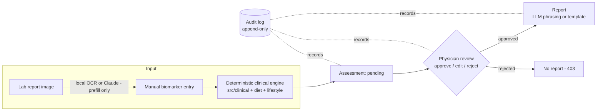

# Physician-Supervised Health System

A physician-supervised diet & lifestyle recommendation web app (Bangladesh
context). All medical decisions come from a **deterministic, cited rule
engine**; lab-report photos are read on the server by an open-source OCR
engine (RapidOCR), optionally by Claude, and an LLM otherwise only phrases
reports; and **no patient ever sees a report their physician hasn't approved**.

## Architecture



Three hard guarantees, each enforced by a test:

| Guarantee | Enforcement |
|---|---|
| Clinical logic never depends on an LLM | `tests/test_llm_isolation.py` — AST scan: `src/clinical`, `src/diet`, `src/lifestyle` never import `src.llm` |
| Contraindicated items never reach recommendations | `src/clinical/contraindication.py` gate runs before ranking; `tests/test_contraindication.py` |
| No report without physician approval | `GET /report/{visit_id}` returns 403 until an `Approval` row exists; `tests/test_api_gate.py` |

Every threshold is cited in `data/reference/*.yaml` (ADA 2024 glucose, ACC/AHA
2017 blood pressure, WHO 2011 hemoglobin, NIH/IOM RDAs, ACSM exercise
prescription). The app runs fully without an Anthropic API key — lab slips are
read on the server (see "Lab-slip reading" below) and reports fall back to a
deterministic Bangla/English template.

## Quickstart

### Backend (FastAPI + SQLite — no external services needed)

```powershell
# one-time setup (from the project root) — requires 64-bit Python 3.13+
py -3.13 -m venv .venv
.venv\Scripts\python.exe -m pip install -e ".[dev]"

# create + seed the database with 4 synthetic demo patients
.venv\Scripts\python.exe scripts\seed_db.py

# run the API  →  http://localhost:8000/docs
.venv\Scripts\python.exe -m uvicorn src.api.main:app --reload
```

> **64-bit Python required.** `scikit-learn`/`scipy` (the recommender
> models' training dependencies, see below) have no prebuilt wheels for
> 32-bit Windows Python and this machine has no C compiler to build them
> from source — use a 64-bit interpreter.

### Dashboard (Next.js — http://localhost:3000)

```powershell
cd dashboard
npm install
npm run dev
```

### Run both together

`npm run dev` from the project root (`scripts/dev.ps1`) starts the API in its
own window, waits for `/health`, then runs the dashboard in the foreground —
useful once both are set up so you don't have to juggle two shells.

> **Known quirk:** this can report a failed exit code (e.g. exit 4) even
> when both servers started fine. `dev.ps1` sets
> `$ErrorActionPreference = "Stop"`, and Windows PowerShell 5.1 treats
> `npm`'s informational `npm notice run ...` lines (written to stderr) as
> terminating errors — the wrapper aborts, but the API (its own process) and
> `next dev` (already attached to your terminal) keep running unaffected.
> If a background/CI runner reports this task as "failed," check
> `http://localhost:8000/health` and `http://localhost:3000` directly before
> assuming the app didn't start.

### Accounts, roles & dashboards

The app has three role-based dashboards, each with its own sign-in page
(chosen from the portal page at `/login`):

| Role | Dashboard | How you get an account |
|---|---|---|
| **Admin** | `/admin` — platform stats, doctor approvals, users, audit feed | Created automatically at first API startup from `ADMIN_EMAIL` / `ADMIN_PASSWORD` in `.env` (default `admin@health.local` / `admin12345`) |
| **Doctor** | `/doctor` — patients, intake, review queue, reports | Self-registers at `/register/doctor` → lands in the admin's **pending approvals**; can sign in only after the admin approves |
| **Patient** | `/patient` — own visits, review status, approved reports | Self-registers at `/register/patient` (active immediately; account is linked to a new patient record) |

`scripts\seed_db.py` also seeds demo logins: `doctor@health.local` /
`doctor12345` (active), `pending.doctor@health.local` / `doctor12345`
(awaiting approval — use it to demo the approval flow), and
`patient@health.local` / `patient12345` (linked to the first demo patient).

All workflow API routes require a signed-in doctor or admin; patients can
only read their own dashboard and their own **approved** reports (the 403
report gate is unchanged). Sessions are HMAC-signed tokens (stdlib-only, no
extra dependencies).

**Deploying.** Set your own `SECRET_KEY` and `ADMIN_PASSWORD` in `.env`. The
API refuses to start on the published defaults whenever the setup is not a
local one: `ENVIRONMENT` is anything but `development`, `DATABASE_URL` is not
SQLite, or `CORS_ORIGINS` names a host other than localhost. On your own
machine the defaults only log a warning.

### Database migrations

The schema is managed with Alembic and applied at API startup, so an existing
`health.db` picks up new columns the next time the API (or `seed_db.py`)
runs — nothing to do by hand. To change the schema, see
`src/db/migrations/README.md`.

### Lab-slip reading (OCR)

A photo of a lab report prefills the intake form; the physician still
confirms every value before anything is scored. By default the photo is read
**on this server** by [RapidOCR](https://github.com/RapidAI/RapidOCR)
(PaddleOCR's PP-OCRv6 models on ONNX Runtime, Apache-2.0, installed with the
backend, models inside the wheel, about 1.5 s a photo on a CPU), so it never
leaves the clinic and needs no key. `src/ocr/lab_report.py` then picks out
fasting glucose, haemoglobin and blood pressure by rule: it straightens a
tilted photo, rebuilds the table's rows, skips look-alikes (2-hour and random
sugar, HbA1c, MCH, reference ranges), converts mmol/L glucose to mg/dL
(× 18.016), and leaves out impossible values, saying all of it in the notes
beside the form.

- **Any way up.** A photo taken on its side or upside down (with no EXIF
  turn) is detected and read again turned; an upside-down page is never
  just mirrored back, because "9.9" upside down reads "6.6".
- **PDF reports.** The PDF a lab sends is read by
  [pypdfium2](https://github.com/pypdfium2-team/pypdfium2) (Chrome's PDFium):
  its own text, exactly as printed, with no OCR; a scanned page saved as PDF
  is rendered at 200 dpi and read like a photo. PDFs are always read on this
  server, whatever `OCR_ENGINE` says.
- **Never a guess.** The first number after a label is its result: when it
  can't be read cleanly the field stays empty rather than taking the next
  column's number (the previous visit's result). The reader's slips inside
  numbers ("5..2", "5,2") are mended; "HbAlc", Hb electrophoresis fractions
  (Hb A, A2, E, F, all percentages) and a haemoglobin over 25 not marked g/L
  are never haemoglobin. A "Fasting" row under a "BLOOD GLUCOSE" heading is
  the fasting glucose.

Measured on 2026-11-09 against 351 fields on made-up slips (five layouts,
three fonts, nine kinds of photo damage: tilt, upside down, on its side,
perspective, shadow, small and blurred, far away): 73.8% right before these
rules, 99.7% after; the one miss is left empty, not wrong.

Chosen on 2026-11-08 against the other open-source engines on GitHub:
PaddleOCR (most accurate, but PaddlePaddle has no Python 3.14 build),
Tesseract (needs a separate native install and does worse on phone photos),
EasyOCR, docTR and Surya (each pulls in PyTorch; Surya's weights carry their
own licence). RapidOCR runs PaddleOCR's models without Paddle.

`OCR_ENGINE` in `.env` picks the reader: `auto` (default — local when
installed, else Claude), `local`, or `claude` (needs `ANTHROPIC_API_KEY`;
the image is sent to Anthropic).

### Optional: enable LLM features

Copy `.env.example` to `.env` and set `ANTHROPIC_API_KEY`. This enables
**LLM-phrased reports** in plain Bangla/English (otherwise a deterministic
template is used) and Claude as a lab-slip reader (`OCR_ENGINE=claude`).

### Optional: PostgreSQL

`docker compose up -d`, then set `DATABASE_URL` in `.env` (see
`docker-compose.yml`) and `pip install "psycopg[binary]"`.

## Datasets

Foods, recipes and exercises are separate datasets, each with its own folder,
raw source, `schema.md`, snapshots and validation report:

| Dataset | Contents | Source (in `raw/`) |
|---|---|---|
| `data/food/bd_food.csv` | 672 foods, nutrients per 100 g | 700-food compilation of FCTB 2013 (Bangladesh), IFCT 2017 (India), USDA SR Legacy |
| `data/recipe/` (`recipes.csv`, `recipe_ingredients.csv`, `recipe_steps.csv`) | 250 Bangladeshi home recipes, 2,349 ingredient rows, 1,105 method steps | Bangladeshi Recipe Dataset 250 v2 (workbook + CSV exports) |
| `data/lifestyle/exercises.csv` | 408 exercises: aerobic, strength (pelvic floor included), flexibility and mobility, balance, breathing | Exercise safety dataset (`exercise_safety_dataset.csv`): 88 cited sources (NHS, AAOS OrthoInfo, NIA, ACE, Otago, the 2024 Compendium...), each exercise rated safe / modify / avoid for pregnancy, hypertension, diabetes, anaemia and knee osteoarthritis and for 12 body regions, with dose, method, easier version, safety notes and a demonstration video |

Every recipe carries a **household frequency score** (`weekly_frequency_score`,
1–10, **10 = the most commonly cooked dish**), which the recipe ranking uses
(see below). Recipe nutrition is never stored: it is computed from the
ingredients against `bd_food.csv` with the dataset's own method (FAO/INFOODS,
USDA retention factors), and reproduces the source workbook exactly for every
recipe that uses no corrected food. The food converter fixes a set of
demonstrable source errors (unconverted IFCT vitamin A, gap fills taken from
the wrong food, blank or placeholder minerals) and logs every changed cell to
`data/food/corrections_log.csv` — see `data/food/schema.md`.

The exercise converter keeps every source row and id (EX001-EX469) and turns
each "avoid" rating into a tag the safety gate excludes for that condition
(`data/reference/contraindications.yaml`); the age and sex rules (no exercise
the dataset rates unsuitable from 65; postnatal and men's pelvic floor rows to
the right sex) are applied through the same gate. Aerobic exercises take
their MET from the 2024 Compendium of Physical Activities
(`data/reference/exercise_met.yaml`: the value the row states, or the code
that names the activity); nine warm-up drills the Compendium has no code for
are never planned as the week's aerobic activity. The source has no Bangla
names, so the app shows the English name and the dataset's English
instructions in both languages, and its per-body-region injury ratings are
carried in the table but not used: the patient record has no injuries yet.

To update a dataset:

1. Put the new raw export in the dataset's `raw/` folder and regenerate:
   `.venv\Scripts\python.exe scripts\convert_datasets.py` (never hand-edit the
   generated CSVs — fix the converter, which documents every decision).
2. Validate: `.venv\Scripts\python.exe scripts\validate_datasets.py` — checks
   types, ranges, ID formats, the frequency score, and referential integrity
   (every `recipe_ingredients.food_id` must exist in `bd_food.csv`), and
   writes a `validation_report.md` into each dataset folder.
3. Snapshot the version: copy the CSVs into the `snapshots/` folders with a
   dated name (e.g. `v1.0_2026-10-08.csv`).
4. Retrain the recommenders (below), then bring the review queue up to date:
   `.venv\Scripts\python.exe scripts\refresh_assessments.py` (add `--dry-run`
   to preview) regenerates every **pending** assessment with the current
   engine and data, audit-logs it, and backs up `health.db` first. Approved
   and rejected assessments are never changed. To start over instead, delete
   `health.db` and run `scripts\seed_db.py`.

`data/reference/*.yaml` (biomarker ranges, RDIs, contraindication rules) are
**real cited clinical constants**, not demo data — edit only with a citation.

## Food and recipe recommendation models

Foods and recipes are ranked as **separate sections** (`src/diet/matcher.py`),
each by its own trained model when one is available, otherwise by a
deterministic formula — same optional-and-gracefully-degrading shape as the
LLM features. The contraindication gate (`src/clinical/contraindication.py`)
is unaffected either way: it always runs first, and the models only ever
re-rank items the gate already allowed.

- **Foods** (per usual portion): only foods tagged `bangladeshi` (listed in FCTB 2013
  or used in a household recipe — 400 of 672) are recommended on their own,
  and seasonings, cooking aromatics (onion, garlic, ginger, chilli) and tea /
  coffee powder never appear in "top foods". A food's fit is multiplied by
  the share of a week's 21 main meals households eat it at
  (`src/diet/habits.py`, `meals_per_week`): every dish that uses it in a
  portion counts, at the meals-per-week midpoint of its frequency score from
  the recipe workbook's `Frequency_Scale` sheet, combined so overlapping
  dishes never pass 21. Rice is eaten at about 15 meals a week, potato 20,
  lentils and eggs 12, a fish one weekly curry uses 1.5, so a food eaten
  twice as often scores twice as high (engine 0.13.0; before that foods took
  the highest 1–10 score of their dishes, which put nearly every food at 3–6
  and let nutrient density pick catla, ash gourd and buttermilk over dal and
  eggs). Whole fruit, which no dish uses, takes the median, 0.7 meals a week.
- **Foods by condition** (`nutrition.condition_foods`, `src/diet/condition_foods.py`):
  for each of the patient's conditions, what to eat and what to avoid, shown
  on the patient's Meals page, the report and the review page. *Eat*: foods
  that are a "source of" one of that condition's nutrients by the EU claim
  thresholds (`data/reference/nutrient_sources.yaml`: 15% of the reference
  value per 100 g, fibre 3 g/100 g or 1.5 g/100 kcal), ranked like top foods
  (most-eaten first), taken from what the patient's whole gate allowed, and
  never a `high_fat` food (no saturated-fat data). *Avoid*: the foods and
  dishes carrying the tags that condition excludes in
  `contraindications.yaml`, the most commonly eaten first. A condition with
  neither (knee osteoarthritis) gets no entry; anaemia excludes nothing, and
  the page says so.
- **Recipes** (per serving): nutritional fit × household familiarity. The
  recipe dataset scores each dish 1–10 for how commonly it is cooked at home
  (10 = most common); the fit is multiplied by 0.25 + 0.75 × (score − 1)/9,
  so among dishes that suit the patient the common ones come first, and a
  dish that does nothing for the patient's targets is never lifted. A trained
  model's fit is multiplied exactly as the formula's is: the models learn
  what suits a patient, not how common a dish is.

A model scores an item for one patient: the nutrient targets, which nutrients
are emphasized, the patient's findings (anaemia, hypertension, diabetes, high
cholesterol) and the sodium limit. Both models are fitted under monotonic constraints, so more
of a nutrient never lowers a score and more sodium never raises one
(`tests/test_trained_models.py` checks this on the real food and recipe
tables). A plan's dishes are scored in a handful of batched calls: an
assessment takes about 0.15 s with the models, 0.08 s on the formula.

To train all three (the exercise model is below):
`.venv\Scripts\python.exe scripts\train_recommenders.py` (about 35 minutes;
`--only food`, `--only recipe` or `--only exercise` for one). Each model
is trained on a synthetic patient-archetype set built from the app's own cited
reference data (no real preference data exists yet): every reference-intake
group × every combination of findings × kidney disease where it changes the
emphasis (168 archetypes), each scored under its full emphasis and under the
shorter lists the meal planner moves through as a day fills up. A
`RandomForestRegressor` and a `HistGradientBoostingRegressor` are tuned
(randomized search, grouped by archetype) alongside an untuned
`GradientBoostingRegressor` and a `LinearRegression` baseline, and compared
against the deterministic formula on patient archetypes held out of training.
The models are judged as they are used — one patient, one list — over the
items the app actually ranks: the Spearman correlation with the noise-free
label and, in brackets, how much of a model's top ten the label also ranks in
its own top ten.

| Model (held out by patient type) | Food | Recipe |
|---|---|---|
| `HistGradientBoostingRegressor` (shipped) | **0.998** (0.97) | **0.998** (0.95) |
| `RandomForestRegressor` | 0.972 (0.94) | 0.974 (0.86) |
| `GradientBoostingRegressor` (untuned) | 0.970 (0.93) | 0.985 (0.88) |
| deterministic formula | 0.787 (0.74) | 0.794 (0.70) |
| `LinearRegression` | 0.426 (0.43) | 0.471 (0.29) |

These figures are not comparable with the 0.957 / 0.914 this table showed
before engine 0.8.0. Those were one correlation pooled over every row of every
patient and all 672 foods, so they also counted telling one patient's scores
from another's, and spices from everything else.

Writes `data/models/{food,recipe}_recommender.joblib` (gitignored —
regenerable build artifacts), `..._metrics.json` (tuned hyperparameters and
permutation feature importance, for the thesis record) and
`thesis/results/{food,recipe}_recommender_comparison.csv`. A model that does
not rank held-out patients better than the formula is not saved, and the
model from an earlier run is removed, so the app scores with the formula. Every
assessment records which backend produced each section:
`result.nutrition.scoring_backend` (foods) and `recipe_scoring_backend` are
`"ml"` or `"linear"`. See `notebooks/04_recommender_training.ipynb` for the
thesis figures.

**Known limitation:** the labels are synthetic. The models learn a
hand-written suitability function (the formula plus saturation caps, a
heme-iron bonus, a sodium penalty and food-group priors by finding — see
`compute_food_label()` in the training script), so the table says how
faithfully a model recovers that function for patient types it has not seen,
not whether patients or physicians prefer its rankings. Labels from real use
(which planned dishes physicians replace at review, for instance) do not
exist yet.

### Exercise model

Each group of the exercise prescription (aerobic, strength, flexibility,
balance) is ranked the same way: by `data/models/exercise_recommender.joblib`
when present, otherwise by the formula in `src/lifestyle/ranking.py` (needs
no modification for the patient's conditions or age, at the patient's level,
no equipment to buy, a dose and a video in the source). Either way it only
orders what the gate and the plannable rules allowed. The label adds what a
guideline singles out for a patient, read off traits the converter derives
from the dataset's own notes: pelvic floor training and the pregnancy-guide
exercises in pregnancy (2019 Canadian guideline, ACOG 804), quadriceps and
hip strengthening and low-impact activity with knee osteoarthritis (OARSI
2019), walking after meals with diabetes, no held positions with
hypertension, gentler aerobic work with anaemia, falls-prevention work from
65 (Cochrane 2019, WHO 2020), low-impact work with obesity. It is trained on
1,120 patient types (sex and age, pregnancy, every combination of four
conditions, fitness level and starting intensity, obesity), each put through
the app's own gate, and judged within each group of a held-out patient type
(top-3: the prescription lists 2-4 per group):

| Model (held out by patient type) | Exercise |
|---|---|
| `HistGradientBoostingRegressor` (shipped) | **0.984** (0.99) |
| `GradientBoostingRegressor` (untuned) | 0.932 (0.93) |
| `RandomForestRegressor` | 0.894 (0.87) |
| `LinearRegression` | 0.857 (0.83) |
| deterministic formula | 0.768 (0.55) |

The same limitation holds: the label is a hand-written function of cited
guidance, so the table says how faithfully the model recovers it, not how
patients or physicians judge the plans. `tests/test_trained_exercise_model.py`
checks the shipped model on real patients: nothing gated or unplannable is
planned, pelvic floor work appears in pregnancy and quadriceps or hip
strengthening with knee osteoarthritis, and its scores move as its monotonic
constraints say.

## Workflow (what the app does)

1. **Intake** — create a patient, then a visit with weight + biomarkers
   (fasting glucose, blood pressure, hemoglobin). Optionally upload a lab
   report image to prefill the form via OCR. The patient record also holds
   what the plan depends on: diagnosed conditions, pregnancy and trimester,
   daily activity, and the foods the patient does not eat (vegetarian, no
   beef, allergies…). Beyond those ticks, single foods and dishes can be
   searched for and left out for that patient: a food goes in every form the
   food table has it in, with every dish that uses it, and neither the
   planner nor the plan editor brings it back. The record can be edited
   later; a plan still awaiting review is rebuilt from the edited record.
   High cholesterol is one of the
   conditions ticked there (no cholesterol value is taken at intake): its
   plan leaves out every dish cooked in a solid fat — ghee, butter,
   vanaspati, margarine, coconut or palm oil — and favours fibre. The food
   table has no saturated fat or cholesterol values, so neither is counted,
   and the review screen says so.
2. **Engine** — the deterministic engine immediately computes BMI (WHO Asian
   cutoffs), risk flags, derived conditions, nutrient targets (RDI by age
   band + emphasis from lab findings and recorded conditions), two
   gate-filtered rankings — **foods** and **home recipes**, separately — a
   week of meals with each day's cooking salt set to stay under the sodium
   limit, and an ACSM FITT-VP exercise prescription: aerobic, strength and
   flexibility work, and balance training from 65 (WHO 2020), each group
   ranked after the gate and picked for variety from exercises done at home
   at the patient's fitness level (beginner exercises only when the plan
   starts light), each with its dose, method, easier version, the dataset's
   notes for the patient's conditions and a demonstration video. Stored as a
   **pending** assessment.
3. **Review** — the physician sees the queue, inspects the full assessment,
   and approves / edits / rejects. Where the engine worked from an
   assumption, emphasized something that is not safe for everyone or could
   not count what matters (no trimester recorded, a patient under 19,
   potassium for hypertension, saturated fat for high cholesterol, exclusions
   that leave meals without a course), the review screen says what to check
   first. Every decision is written to the
   append-only audit log.
4. **Report** — only after approval, `GET /report/{visit_id}?lang=bn|en`
   returns the patient report (LLM-phrased if configured, template otherwise).
5. **Today** — the patient portal's daily task list (`/patient/today`, built
   for phones first): today's meals from the approved week plan and the
   exercise groups due today, each ticked off when done, with a streak of
   days on which every task was done and the last seven days at a glance.
   The prescription gives days a week, not days; `src/lifestyle/schedule.py`
   spreads each group over the Saturday-to-Friday week (strength never on
   consecutive days, ACSM). Ticks are kept per patient per day
   (`daily_task_logs`, `GET/PUT /me/tasks`, `src/api/daily_tasks.py`), only
   today can be changed, and "today" is the clinic's day (UTC+6,
   `CLINIC_UTC_OFFSET_HOURS`). Nothing in the engine reads them.

## Tests

```powershell
.venv\Scripts\python.exe -m pytest      # engine and API
cd dashboard; npm test                   # dashboard display helpers
```

`tests/test_risk_scoring.py` is the threshold validation table (doubles as the
thesis validation table — exported to CSV by `notebooks/03_results_figures.ipynb`).
The Python suite runs against a throwaway database, never your `health.db`,
and on the deterministic scorers; `tests/test_trained_models.py` and
`tests/test_trained_exercise_model.py` run the same rules through the trained
recommenders when `data/models/` has them and are skipped otherwise.

`.github/workflows/ci.yml` runs both suites, the dashboard lint and a
production build on every push to `main` and every pull request.

## Project layout

```
data/          datasets (schema.md + snapshots + validation reports) and cited reference YAMLs
data/models/   trained food, recipe and exercise recommender artifacts (gitignored, regenerable — see scripts/train_recommenders.py)
src/clinical   deterministic rules: BMI, risk scoring, deficiency → targets, contraindication gate
src/diet       food DB, recipe nutrition (computed from ingredients), matcher, meal plan, recommender (ML backend)
src/lifestyle  exercise DB, ranking (formula + optional trained model), ACSM FITT-VP prescription, intensity scaling
src/ocr        local lab-slip reading: RapidOCR + rule-based biomarker parser (prefill only)
src/llm        Claude OCR (optional) + report phrasing (env-gated; app fully works without it)
src/api        FastAPI: intake, review, report (403-gated), patients
src/db         SQLAlchemy models: Patient, Visit, Assessment, Approval, AuditLog; Alembic migrations
src/core       config, logging, append-only audit helpers
dashboard/     Next.js physician UI
tests/         validation tables + gate/isolation tests + synthetic fixtures
scripts/       convert_datasets.py, validate_datasets.py, seed_db.py, train_recommenders.py
notebooks/     dataset audit, cross-validation, thesis figure export, recommender training
thesis/        diagrams / figures / results
```
